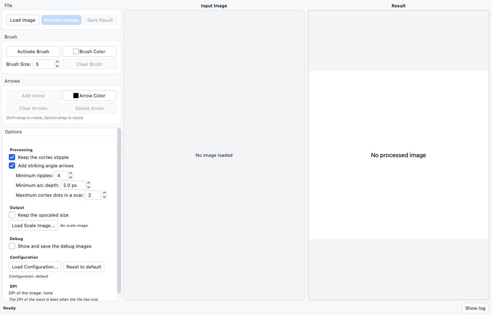

# Interface

## Introduction

This page describes the controls of the Lithic Editor and Annotator GUI.

## Start the GUI

Run this command in a terminal:

```bash
lithic-editor --gui
```

## Main window



The main window has these areas.

### File (left column, first pane)

| Button | Function |
|--------|----------|
| **Load Image** | Opens an image file. Accepted formats: PNG, JPEG, BMP and TIFF. The application crops the image to its content. |
| **Process Image** | Starts ripple removal. Available after you load an image. |
| **Save Result** | Saves the processed image with its arrows. Available after processing. |

### Brush (left column, second pane)

The brush draws on the copy of the input image in the **Input Image** panel. It does not change the file on disk. Processing uses the edited copy.

- **Activate Brush**: turns the brush on or off. The button shows "Brush Active" when the brush is on.
- **Brush Color**: opens a color dialog. The swatch on the button shows the color. White erases, black draws. White is the default.
- **Brush Size**: the brush size in pixels, 1 to 20. The default is 5.
- **Clear Brush**: removes all brush marks from the input image.

### Arrows (left column, third pane)

These controls become available after processing. See [Arrow Annotations](arrows.md).

- **Add Arrow**: puts a new arrow at the center of the processed image.
- **Arrow Color**: opens a color dialog. New arrows get this color.
- **Delete Arrow**: removes the selected arrow.
- **Clear Arrows**: removes all arrows.

The pane also shows the mouse actions: Shift+drag to rotate, Option+drag (macOS) or Alt+drag (Windows, Linux) to resize.

### Options (left column, lowest pane)

**Processing**

- **Keep the cortex stipple**: keeps the cortex stipple in the result. On by default.
- **Add striking angle arrows**: measures the direction of the blow from the ripples of each scar and adds an arrow. On by default. See [Striking angles](striking-angles.md).
- **Minimum ripples**, **Minimum arc depth**, **Maximum cortex dots in a scar**: the three thresholds of the measurement. They start at the values of the configuration file and replace them for the next run. They are available only when the arrow option is on.

**Output**

- **Keep the upscaled size**: keeps the result at the upscaled working size. Off by default. A warning opens when you set it. See [Output](output.md).
- **Load Scale Image...**: selects an optional scale bar image scanned with the drawing. The label next to the button shows the file name.

**Debug**

- **Show and save the debug images**: shows the debug images in the **Processing Steps** panel and writes them to `image_debug/<name>/`. Off by default.

**Configuration**

- **Load Configuration...**: selects a configuration file. See [Configuration](configuration.md).
- **Reset to default**: uses the configuration file shipped with the package.
- The label shows the file in use. Point at the label to see its full path.

**DPI**

- Shows the DPI found in the loaded image. When the file has a DPI, that DPI is kept.
- When the file has no DPI, two options appear:
    - **No DPI value**: the saved file gets no DPI tag.
    - **Set the DPI**: the saved file gets this DPI tag (72 to 1200).

### Input Image (middle)

Shows the loaded image after the crop to its content. Brush marks appear here.

### Result (right)

Shows the processed image. Arrows appear here.

### Processing Steps (far right)

Shows the debug images. The panel is visible only when **Show and save the debug images** is on.

### Status row (bottom)

Shows the current state, for example "Ready", "Processing..." or "Processing complete". A progress bar is visible during processing.

**Show log** opens the processing log above the status row. The log shows messages from the application and the pipeline: DPI, image size, measured line width and hatch gap, upscale decisions, striking angles and save paths. Click **Hide log** to close it.

## Next steps

- [Processing Images](processing.md)
- [Output](output.md)
